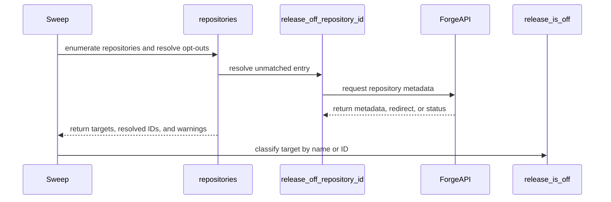

<!-- coderabbit-ai-generated:v1 -->

<!-- This is an auto-generated comment: summarize by coderabbit.ai -->
<!-- review_stack_entry_start -->

<a href="https://app.coderabbit.ai/change-stack/plurano/horistes/pull/234?scope=ghh_OusAJGA4HG8ljoOV0wJvVx8NmnZIjc2DdjmxOu0xZWA&amp;cs_source=review_comment"><picture><source media="(prefers-color-scheme: dark)" srcset="https://storage.googleapis.com/coderabbit_public_assets/review-stack-buttons-v1/explain-change-dark.svg"><source media="(prefers-color-scheme: light)" srcset="https://storage.googleapis.com/coderabbit_public_assets/review-stack-buttons-v1/explain-change.svg"></picture></a>

<!-- review_stack_entry_end -->
<!-- This is an auto-generated comment: review paused by coderabbit.ai -->

> [!NOTE]
> ## Reviews paused
> 
> It looks like this branch is under active development. To avoid overwhelming you with review comments due to an influx of new commits, CodeRabbit has automatically paused this review. You can configure this behavior by changing the `reviews.auto_review.auto_pause_after_reviewed_commits` setting.
> 
> - Last reviewed commit: 5f70ad27b885ee534c38453f6107ecf8070e897d
> 
> Use the following commands to manage reviews:
> - `@coderabbitai resume` to resume automatic reviews.
> - `@coderabbitai review` to trigger a single review.
> 
> Use the checkboxes below for quick actions:
> - [ ] <!-- {"checkboxId":"7f6cc2e2-2e4e-497a-8c31-c9e4573e93d1"} --> Resume reviews
> - [ ] <!-- {"checkboxId":"e9bb8d72-00e8-4f67-9cb2-caf3b22574fe"} --> Trigger review

<!-- end of auto-generated comment: review paused by coderabbit.ai -->
<!-- recent_review_status_start -->

No actionable comments were generated in the recent review.

<!-- recent_review_status_end -->
<!-- walkthrough_start -->

<strong>Walkthrough</strong>

<dl>
<dd>
 

The merge train now limits `release_off` entries, resolves unmatched entries through repository metadata, and uses repository IDs during release classification. Documentation and tests describe lookup outcomes and failure handling. Cryptography justification entries have updated line references.

**Changes: Moved Repository Release Opt-Outs**

|Layer / File(s)|Summary|
|:---|:---|
|**Entry limit and name matching**   `tools/merge_train.py`, `tests/test_merge_train.py`, `.github/workflows/merge-train.yml`|The setting rejects more than 50 whitespace-separated entries before parsing. Direct name matching uses case-folded values. Tests cover the limit and case-insensitive matches.|
|**Repository metadata resolution**   `tools/merge_train.py`, `tests/test_merge_train.py`|Unmatched entries are resolved through repository metadata. Resolution permits one redirect to an allowed endpoint on the API origin. Tests cover missing repositories, lookup responses, unsafe redirects, malformed metadata, and repository ID matching.|
|**Sweep behavior and documented policy**   `tools/merge_train.py`, `tests/test_merge_train.py`, `README.md`, `docs/adr/*`|The sweep uses resolved IDs for release classification and adds lookup warnings to reports. A resolution failure disables releases for the affected installation during that sweep. The README and ADRs describe the policy and its verification cases.|

**Cryptography Justification References**

|Layer / File(s)|Summary|
|:---|:---|
|**Updated source and test references**   `.bestpractices.json`|Cryptography justifications now point to updated source and test line locations. Their text and status values are unchanged.|

<!-- change_assessment_start -->
**Estimated code review effort:** 3 (Moderate) | ~25 minutes

<!-- change_assessment_commit:"5f70ad27b885ee534c38453f6107ecf8070e897d" -->
<!-- change_assessment_priority:{"version":1,"urgency":"p2","manual":false} -->
**Change:** Bug fix
<!-- change_assessment_end -->

### Sequence Diagram(s)

**Possibly related issues**

- plurano/horistes#230 asks for former repository names to resolve to current repositories. This change resolves unmatched entries through forge metadata and matches repositories by ID. The issue's fleet-wide sweep of caller entries is not described as part of this change.

**Suggested reviewers:** `sourcery-ai`

</dd>
</dl>

<!-- walkthrough_end -->

<strong>Merge Risk:</strong> <strong><picture></picture> Minimal</strong> · up to <code>5f70a</code>

<dl>
<dd>
 

<!-- final_review_risk_start -->
<!-- final_review_risk_label
**Merge Risk:** **⚪ Minimal** · up to `5f70a`
-->
<!-- final_review_risk_coverage:{"sourceCommitId":"5f70ad27b885ee534c38453f6107ecf8070e897d","coveredCommitId":"5f70ad27b885ee534c38453f6107ecf8070e897d","kind":"reviewed"} -->

This change keeps a release_off opt-out working after a repository is transferred or renamed. Lookups are bounded: at most 50 entries, one validated redirect, and a check against the sweep time budget before each lookup. Any lookup problem other than a 404 stops release runs for that installation and writes a warning, so the safe failure mode is preserved. No unresolved merge risk remains.
<!-- final_review_risk_end -->

</dd>
</dl>

<!-- pre_merge_checks_walkthrough_start -->

<strong>Pre-merge checks: <picture></picture> 4</strong>

<dl>
<dd>
 

|         Check name         |                                             Status                                             | Explanation                                                                                                                                                                                               |
| :------------------------ | :--------------------------------------------------------------------------------------------: | :-------------------------------------------------------------------------------------------------------------------------------------------------------------------------------------------------------- |
|         Title check        |  | The title names the main change: a release_off opt-out keeps working after a repository moves. It uses the conventional commit type and scope. It matches the summary and objectives, which describe mov… |
|      Description check     |  | The description follows the template sections (Description, Pre-Merge Verification Checklist) and includes the required checklist items. It explains the change, rationale, bounds, fail-closed behavior… |
|     Linked Issues check    |  | Check skipped because no linked issues were found for this pull request.                                                                                                                                  |
| Out of Scope Changes check |  | Check skipped because no linked issues were found for this pull request.                                                                                                                                  |

<strong>Full details: Title check</strong>

<dl>
<dd>
 

**Explanation**

The title names the main change: a release_off opt-out keeps working after a repository moves. It uses the conventional commit type and scope. It matches the summary and objectives, which describe move-following lookups for release_off entries.

</dd>
</dl>

<strong>Full details: Description check</strong>

<dl>
<dd>
 

**Explanation**

The description follows the template sections (Description, Pre-Merge Verification Checklist) and includes the required checklist items. It explains the change, rationale, bounds, fail-closed behavior, and tests. The author marks the checklist items as complete. The description cites ADR-0100 and the test coverage. It does not fully match the template's Description guidance for architectural rationale, but the rationale is present under 'Why' and 'What changes'.

</dd>
</dl>

</dd>
</dl>

<!-- pre_merge_checks_walkthrough_end -->
<!-- finishing_touch_checkbox_start -->

<strong>Finishing Touches</strong>

<dl>
<dd>
 

<strong>Generate unit tests (beta)</strong>

<dl>
<dd>
 

- [ ] <!-- {"checkboxId": "6ba7b810-9dad-11d1-80b4-00c04fd430c8", "radioGroupId": "utg-output-choice-group-7082528337"} --> Commit to this branch
- [ ] <!-- {"checkboxId": "f47ac10b-58cc-4372-a567-0e02b2c3d479", "radioGroupId": "utg-output-choice-group-7082528337"} --> Create a new PR

</dd>
</dl>

</dd>
</dl>

<!-- finishing_touch_checkbox_end -->

<!-- autopilot:start -->
- [ ] <!-- {"checkboxId":"2708ad07-9f24-4260-9c11-7dc76a49f2e3"} --> <strong title="Keep fixing CodeRabbit findings and required CI, and resolving merge conflicts">Autofix</strong> · Keep fixing CodeRabbit findings and required CI, and resolving merge conflicts
<!-- autopilot:end -->
<!-- tips_start -->

Thanks for using [CodeRabbit](https://coderabbit.ai?utm_source=oss&utm_medium=github&utm_campaign=plurano/horistes&utm_content=234)! It's free for OSS, and your support helps us grow. If you like it, consider giving us a shout-out.

<strong>Share</strong>

<dl>
<dd>
 

- [X](https://twitter.com/intent/tweet?text=I%20just%20used%20%40coderabbitai%20for%20my%20code%20review%2C%20and%20it%27s%20fantastic%21%20It%27s%20free%20for%20OSS%20and%20offers%20a%20free%20trial%20for%20the%20proprietary%20code.%20Check%20it%20out%3A&url=https%3A//coderabbit.ai)
- [Mastodon](https://mastodon.social/share?text=I%20just%20used%20%40coderabbitai%20for%20my%20code%20review%2C%20and%20it%27s%20fantastic%21%20It%27s%20free%20for%20OSS%20and%20offers%20a%20free%20trial%20for%20the%20proprietary%20code.%20Check%20it%20out%3A%20https%3A%2F%2Fcoderabbit.ai)
- [Reddit](https://www.reddit.com/submit?title=Great%20tool%20for%20code%20review%20-%20CodeRabbit&text=I%20just%20used%20CodeRabbit%20for%20my%20code%20review%2C%20and%20it%27s%20fantastic%21%20It%27s%20free%20for%20OSS%20and%20offers%20a%20free%20trial%20for%20proprietary%20code.%20Check%20it%20out%3A%20https%3A//coderabbit.ai)
- [LinkedIn](https://www.linkedin.com/sharing/share-offsite/?url=https%3A%2F%2Fcoderabbit.ai&mini=true&title=Great%20tool%20for%20code%20review%20-%20CodeRabbit&summary=I%20just%20used%20CodeRabbit%20for%20my%20code%20review%2C%20and%20it%27s%20fantastic%21%20It%27s%20free%20for%20OSS%20and%20offers%20a%20free%20trial%20for%20proprietary%20code)

</dd>
</dl>

<!-- tips_end -->
<!-- recent_review_start -->

<h6>

<strong><picture></picture> Recent review info</strong>

<dl>
<dd>
 

<!-- review_info_content -->

<strong><picture><source media="(prefers-color-scheme: dark)" srcset="https://storage.googleapis.com/coderabbit_public_assets/review-comment-icons-v1/cog-dark.svg"></picture> Run configuration</strong>

<dl>
<dd>
 

- **Source mode**: Auto
- **Repository**: Unavailable
- **Branch**: Unavailable
- **File**: No configuration file from this repository applied
- **Commit**: Unavailable
- **Layers**: defaults
- **Review profile**: CHILL
- **Plan**: Advanced
- **Run ID**: `7d635f05-1ed2-47dc-b222-6d02ff169c9e`

</dd>
</dl>

<strong><picture><source media="(prefers-color-scheme: dark)" srcset="https://storage.googleapis.com/coderabbit_public_assets/review-comment-icons-v1/git-commit-horizontal-dark.svg"></picture> Commits</strong>

<dl>
<dd>
 

Reviewing files that changed from the base of the PR and between 28b9f4de086263708598ffd12ddc6b18f41c6830 and 5f70ad27b885ee534c38453f6107ecf8070e897d.

</dd>
</dl>

<strong><picture><source media="(prefers-color-scheme: dark)" srcset="https://storage.googleapis.com/coderabbit_public_assets/review-comment-icons-v1/file-plus-corner-dark.svg"></picture> Files selected for processing: 1</strong>

<dl>
<dd>
 

* `docs/adr/0100-release-off-follows-a-moved-repository.md`

</dd>
</dl>

<strong><picture><source media="(prefers-color-scheme: dark)" srcset="https://storage.googleapis.com/coderabbit_public_assets/review-comment-icons-v1/file-similar-dark.svg"></picture> Files skipped from review as they are similar to previous changes: 1</strong>

<dl>
<dd>
 

* docs/adr/0100-release-off-follows-a-moved-repository.md

</dd>
</dl>

**Included review availability:** This review used your included allowance. Your plan provides up to 1 included review per hour; 0 remain after this review.

</dd>
</dl>

</h6>

<!-- recent_review_end -->
